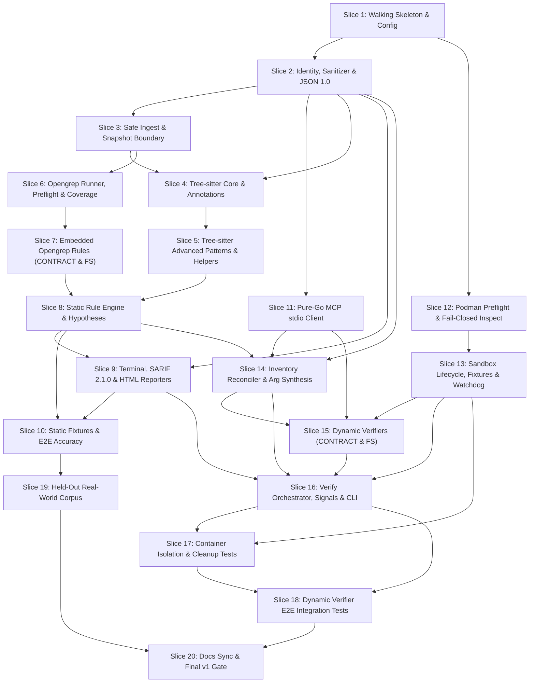

# `telltale` v1 — Phased Vertical-Slice Implementation Plan

## Goal Description

Build **`telltale`** (`github.com/Timatoot/telltale`) from the current greenfield checkout (`go.mod` on Go `1.26.11`, `.golangci.yml`, and stub `cmd/telltale/main.go`) into the complete v1 local-first, static-first, canary-verified Python `stdio` MCP security scanner defined in [docs/SPEC.md](SPEC.md) and [docs/ARCHITECTURE.md](ARCHITECTURE.md).

The plan is organized into **6 phases / 20 vertical slices**. Each numbered milestone lists its dependencies, file owners and verification. Implement the separately gated parts of Slices 2, 8 and 13 in order. Each milestone:
- Lists owned files, including CLI integration points. Concurrent branches run checks in separate checkouts.
- Declares explicit **Depends on**, **Parallelizable with**, **Target files (Create/Modify)**, **numbered checkbox Tasks**, and an exact **CLI Verification** command.
- Starts with **Slice 1** as a working end-to-end walking skeleton with build, race unit tests, and `golangci-lint` green.
- Embeds explicit test tasks tracing every security boundary risk and every row of the Required Edge-Case Test Matrix in `docs/ARCHITECTURE.md` (§4.4, §4.5, §5).
- Respects all v1 non-goals, dependency freeze constraints, and fail-closed sandbox invariants in [AGENTS.md](../AGENTS.md).

---

## Confirmed Decisions

> [!NOTE]
> 1. **`.golangci.yml` path exclusion (Slice 1):** Update [.golangci.yml](../.golangci.yml#L14) from `internal/(sast|sandbox)/` to `internal/(opengrep|sandbox)/` to match [docs/ARCHITECTURE.md](ARCHITECTURE.md#L37).
> 2. **Sole CGo dependency (Slice 4):** Approved adding `github.com/tree-sitter/go-tree-sitter` and `github.com/tree-sitter/tree-sitter-python` to [go.mod](../go.mod). All other packages remain Go stdlib only.
> 3. **Frozen v1 Rule IDs (Schema `1.0` Public Contract):**
>    - `POISON-INVISIBLE-UNICODE` (`static_status: proven`, CWE-116 / CWE-1007)
>    - `POISON-PROMPT-OVERRIDE` (`static_status: suspected`, CWE-77 / CWE-74)
>    - `POISON-HIDDEN-EXFIL` (`static_status: suspected`, CWE-200)
>    - `POISON-CROSS-TOOL-MISLEAD` (`static_status: suspected`, CWE-451)
>    - `POISON-RUNTIME-DRIFT` (`origin: runtime`, `static_status: none`, `dynamic_status: confirmed`, CWE-345)
>    - `CONTRACT-READONLY-WRITE` (`readOnlyHint=true` + filesystem write/delete/exec sink, CWE-732)
>    - `CONTRACT-DESTRUCTIVE-MUTATION` (`destructiveHint=false` + destructive delete/overwrite/exec sink, CWE-732)
>    - `CONTRACT-OPENWORLD-NETWORK` (`openWorldHint=false` + outbound network sink, `dynamic_status: not_applicable`, CWE-918 / CWE-284)
>    - `FS-PATH-TRAVERSAL` (tainted tool param → filesystem read sink, CWE-22)
> 4. **Held-Out Real-World Corpus (Slice 19):** Curate a shortlist of 5 permissively licensed (MIT / Apache-2.0 / BSD) Python MCP server repositories at pinned commits upon reaching Slice 19.

---

> 5. **SARIF schema validation (Slice 9):** `check-jsonschema` is approved as a test-only dependency for offline validation of generated SARIF.

## Approved rule severities

SPEC §5 fixes the default threshold at high. Slice 8 uses the approved assignments below. Runtime matches of the same text rule inherit its severity. Verification changes evidence and status independently of severity.

| Severity | Rule IDs | Rationale |
| --- | --- | --- |
| High | `POISON-INVISIBLE-UNICODE`, `POISON-HIDDEN-EXFIL`, `CONTRACT-READONLY-WRITE`, `CONTRACT-DESTRUCTIVE-MUTATION`, `FS-PATH-TRAVERSAL` | Hidden text or a credential directive merits review, as does an apparent violation of a filesystem or mutation boundary. |
| Medium | `POISON-PROMPT-OVERRIDE`, `POISON-CROSS-TOOL-MISLEAD`, `POISON-RUNTIME-DRIFT`, `CONTRACT-OPENWORLD-NETWORK` | Context matters for imperative language, textual drift and the purpose of a network call. Drift alone establishes that text changed. |

## Architecture Dependency Graph



---

## Architecture Risk & Edge-Case Traceability Matrix

Every security invariant, residual risk, and row of the Required Edge-Case Test Matrix in `docs/ARCHITECTURE.md` (§4.4, §4.5, §5) is mapped to explicit test tasks below:

| Risk ID | Architecture Area & Risk Summary | Covered In Slice(s) |
| :--- | :--- | :--- |
| **RISK-01** | **Ingest / Snapshot (§4.4, §5 Row 1):** Symlink loops, symlink to `/etc/passwd`, FIFOs/sockets/devices, count (10k) / file-size (1 MiB) / total (64 MiB) caps, NUL bytes, non-UTF-8, BOM, CRLF, 1 MiB single-line file, target `.semgrepignore`/`.gitignore`/`.git`/`# nosemgrep` bypass, TOCTOU divergence | Slice 3, Slice 4, Slice 6, Slice 7 |
| **RISK-02** | **Static Extraction (§4.3, §5 Row 2):** 10k-deep nested CST DoS (`depth_exceeded` at depth 512), `ToolAnnotations` via var/dict/`**kwargs`/imported const defaulting falsely instead of `null` + coverage, aliased `FastMCP`, `add_tool(fn)`, low-level `list_tools`/`call_tool`, f-string/var descriptions (`unresolved`), duplicate tool names (same-file & cross-file), cross-file helper tracking | Slice 4, Slice 5 |
| **RISK-03** | **Opengrep Boundary (§4.4, §5 Row 3):** Silent coverage loss when `errors[]` present on exit `0`, engine-skipped files absent from `paths.scanned`, unsupported version, missing binary, 64 MiB stdout OOM, rejected CLI flag (preflight self-test → exit `2`), `# nosemgrep` suppression | Slice 6, Slice 7 |
| **RISK-04** | **`--run-cmd` & CLI Injection (§4.2):** Shell interpolation, unquoted metacharacters (`` \| & ; < > ( ) $ ` ``), unterminated quotes, empty argv, missing `--image` with `--verify`, unintended variable/glob/tilde expansion | Slice 1 |
| **RISK-05** | **Container Isolation & Image Hazards (§4.4, §5 Rows 9–10):** Rootful/remote Podman, missing cgroup v2 controllers (`cpu`, `memory`, `pids`), non-`crun` runtime, missing local image (never pull/build), `containers.conf` `env_host=true` or extra default volume, image `VOLUME` & `USER root`, missing writable `HOME`/cache on read-only rootfs, pids-limit hit, post-start cgroup limit mismatch | Slice 12, Slice 13, Slice 17 |
| **RISK-06** | **Container/Temp Cleanup & SELinux `:Z` Safety (§4.4, §5 Row 11):** Orphaned containers/temp dirs after normal exit, session timeout, `--verify-budget` exhaustion, `SIGINT`, double `SIGINT`, `SIGKILL` of the audit process (independent run cleanup, plus running-container timeout), cross-run deletion interference, `:Z` misapplied outside fresh temp dirs | Slice 13, Slice 16, Slice 17, Slice 18 |
| **RISK-07** | **Hostile MCP stdio Wire Boundary (§4.4, §5 Row 4):** Server→client `roots/list` & `sampling/createMessage` requests, stray `print()` lines (>64 KiB cap), 2 MiB frame without newline (`response_truncated`), repeated pagination cursor, >50 pages / >1,000 tools, mismatched/duplicate IDs (>16), mid-call server exit, stderr flood (>64 KiB ring buffer), `tools/list_changed` observation | Slice 11 |
| **RISK-08** | **Live Inventory Reconciliation (§3 SPEC, §4.5, §5 Row 5):** False positives on FastMCP-reformatted docstrings or env-conditional static-only tools, live-only benign tool vs live-only bidi tool, ambiguous duplicate tool names, unresolved static descriptions wrongly diffed | Slice 14, Slice 18 |
| **RISK-09** | **Workspace Mutation Oracle & Watchdog (§4.5, §5 Row 7):** atime/mtime-only false positives, chmod/symlink/hardlink/FIFO/file-to-dir mutations, host-side traversal via container-created symlinks (`os.Root`/`Lstat`), background writer (`noisy_workspace`), >8 MiB file partial hash, disk-fill (>256 MiB) & 100k-file creation watchdog `resource_limit` (including documented 250ms burst residual risk) | Slice 13, Slice 15, Slice 18 |
| **RISK-10** | **Path Traversal Canary Hygiene & Oracle (§4.5, §5 Row 6):** Canary token leaking into payloads or artifacts, evasion via base64 (`data`, `resource.blob`, 3 alignments), hex, `structuredContent`, split content items, or error responses; truncated/`isError` without canary (`inconclusive`); missing `{workspace}` falsely tested instead of `skipped` | Slice 13, Slice 15, Slice 18 |
| **RISK-11** | **Argument Synthesis Schema DoS (§4.5, §5 Row 8):** `oneOf`/`anyOf`/`allOf`, unresolved `$ref`, or object recursion > depth 3 failing to return `inconclusive` (`unsupported_schema`) | Slice 14 |
| **RISK-12** | **Safe, Deterministic Reporting (§4.1, §4.6, §5 Row 12):** Bidi/zero-width/control/ANSI injection across terminal/HTML/SARIF, HTML `<script>` XSS, SARIF `message.markdown` forbidden, secret/canary token leakage, non-deterministic JSON across checkout paths, unstable fingerprints across line-shifting edits | Slice 2, Slice 9, Slice 10, Slice 18 |
| **RISK-13** | **Policy Gate, Exit-Code Precedence & Atomic Artifacts (SPEC §5, ARCH §5 Row 13):** Dynamic `not_reproduced`/`inconclusive`/`skipped` downgrading gating, `--verified-only` handling, `--strict --verify` without `{workspace}` exiting `3` when no finding gates, precedence `2 > 1 > 3 > 0`, partial artifacts left behind on write failure or exit `2` | Slice 1, Slice 8, Slice 9, Slice 10, Slice 16, Slice 18 |

---

## Proposed Changes (Phased Vertical Slices)

### Phase 1: Walking Skeleton, Contracts & Safe Repository Ingestion

---

#### Slice 1: Minimal Walking Skeleton, CLI Config & Test/Lint Harness

- **Depends on:** None (first slice)
- **Parallelizable with:** None (establishes the CLI harness)
- **Target files (5 total — 2 Modify, 3 Create):**
  - `[MODIFY]` `.golangci.yml`
  - `[CREATE]` `internal/config/config.go`
  - `[CREATE]` `internal/config/config_test.go`
  - `[MODIFY]` `cmd/telltale/main.go`
  - `[CREATE]` `cmd/telltale/main_test.go`
- **Tasks:**
  1. [x] Update `.golangci.yml` line 14 from `internal/(sast|sandbox)/` to `internal/(opengrep|sandbox)/` to match `docs/ARCHITECTURE.md` §3, and verify `golangci-lint fmt` and `golangci-lint run` execute cleanly.
  2. [x] Implement `internal/config/config.go` with `audit` subcommand flag parsing (`--json`, `--sarif`, `--html`, `--no-color`, `--fail-on`, `--verified-only`, `--strict`, `--verify`, `--image`, `--run-cmd`, `--timeout`, `--verify-budget`), strict flag validation (e.g., `--verify` requires `--image`, invalid `--fail-on` or non-positive durations fail), and the shell-free `--run-cmd` tokenizer (ASCII whitespace split, `'...'` literal, `"..."` `\"`/`\\` escapes, outside `\` escape, `{workspace}` → `/workspace` substitution, tracking `HasWorkspaceClaim`).
  3. [x] **[RISK-04 Test]** Write `internal/config/config_test.go` covering valid flag combinations, `--verify` without `--image` → fatal error, `--run-cmd` unquoted shell metacharacters (``| & ; < > ( ) $ ` ``), unterminated quotes, empty argv, non-expansion of `$VAR`/`~`/`*`, and `{workspace}` substitution inside tokens.
  4. [x] Wire the CLI to validate the repo directory, print the empty scan summary, and stage and rename a requested JSON file in its destination directory. This skeleton exercises exits 0 and 2. Slice 2 owns the public report shape and Slice 8 owns policy evaluation. Reserve unfinished CLI modes until their implementation slice so an explicit verify request cannot return a successful empty audit.
  5. [x] **[RISK-13 Test]** Write `cmd/telltale/main_test.go` testing CLI exit `0` on an empty temp directory, exit `2` on invalid flags / missing repo path / rejected `--run-cmd`, and exit `2` with zero leftover temp files when `--json` points to an unwritable directory.
- **CLI Verification:**
  ```bash
  CGO_ENABLED=1 go build -o bin/telltale ./cmd/telltale && go test -race -count=1 ./... && golangci-lint fmt ./... && golangci-lint run ./...
  ```

---

#### Slice 2: Canonical Identity, Fingerprints, Untrusted-Text Sanitizer & JSON `1.0` Renderer

- **Depends on:** Slice 1
- **Parallelizable with:** Slice 12
- **Target files (8 total across two parts):**
  - `[CREATE]` `internal/model/report.go`
  - `[CREATE]` `internal/model/identity.go`
  - `[CREATE]` `internal/model/identity_test.go`
  - `[CREATE]` `internal/report/sanitize.go`
  - `[CREATE]` `internal/report/sanitize_test.go`
  - `[CREATE]` `internal/report/json.go`
  - `[CREATE]` `internal/report/json_test.go`
  - `[MODIFY]` `cmd/telltale/main.go`
- **Tasks:**
  1. [x] First deliver the typed report fields, status/reason enums and deterministic ordering from ARCH §4.1 in `internal/model/report.go`. Implement `internal/model/identity.go` per `docs/ARCHITECTURE.md` §4.6: `ToolID` (`py:<relpath>:<name>`, `#<n>` for same-file duplicates ordered by byte offset, `py:<relpath>:?<n>` for unresolved, `live:<name>` for runtime-only) and SHA-256 NUL-separated `Fingerprint` for `POISON` static, `POISON` runtime (`<runtime>` path), `CONTRACT`, and `FS` (strictly content-based, zero line/column numbers).
  2. [x] **[RISK-12 Test]** Write `internal/model/identity_test.go` proving fingerprints stay identical when line/column spans shift, differ when anchor/callee/ordinal/field changes, and match exact spec formatting for duplicates, unresolved tools, and runtime findings.
  3. [x] Gate the model and identity work with `go test -race -count=1 ./internal/model/...`. In the second part implement `internal/report/sanitize.go`: `<U+XXXX>` escaping for bidi, zero-width, and control codepoints; visible escaping of the ESC control in ANSI sequences (e.g., `<U+001B>[31m`); bounded excerpt truncation; high-entropy secret redaction (e.g., bearer/API tokens); canary-token assertion/scrubbing guard; and `NormalizeDocstring` (CRLF→LF, `inspect.cleandoc`-equivalent indentation stripping, trimming blank lines & trailing whitespace, with **zero** Unicode NFC/NFKC normalization).
  4. [x] **[RISK-12 Test]** Write `internal/report/sanitize_test.go` testing bidi overrides (`U+202E`, `U+2066`), zero-width chars (`U+200B`, `U+FEFF`), ANSI CSI sequences (assert visible `<U+001B>` and absence of raw ESC, including in decoded JSON strings), high-entropy token redaction, canary scrubbing, byte truncation, and verifying `NormalizeDocstring` preserves non-normalized Unicode codepoints verbatim.
  5. [x] Implement `internal/report/json.go` rendering immutable `*model.ScanReport` into Canonical JSON `1.0` with guaranteed non-nil empty arrays (`[]` instead of `null`), repo-relative POSIX paths, no timestamps/host paths, and canary-token absence check.
  6. [x] **[RISK-12 Test]** Write `internal/report/json_test.go` asserting schema `1.0` structure, byte-identical output across two runs from different checkout paths, and failure/redaction if a canary token attempts to leak into serialized output.
  7. [x] Update `cmd/telltale/main.go` to use `report.RenderJSON` for `--json`.
- **CLI Verification:**
  ```bash
  go test -race -count=1 ./internal/model/... ./internal/report/... ./cmd/telltale/... && golangci-lint run ./...
  ```

---

#### Slice 3: Symlink-Safe Repository Ingestion & Per-Run Snapshot Boundary

- **Depends on:** Slice 2
- **Parallelizable with:** Slice 11, Slice 12
- **Target files (4 total — 2 Modify, 2 Create):**
  - `[CREATE]` `internal/ingest/snapshot.go`
  - `[CREATE]` `internal/ingest/snapshot_test.go`
  - `[MODIFY]` `cmd/telltale/main.go`
  - `[MODIFY]` `cmd/telltale/main_test.go`
- **Tasks:**
  1. [ ] Implement `internal/ingest/snapshot.go`: open target repo via `os.OpenRoot`, walk deterministically using non-following `Lstat`, skip `.git` without reading VCS metadata, reject symlinks/FIFOs/sockets/devices/other non-regular files (recording `files_skipped`), enforce budgets (≤10,000 candidate files, ≤1 MiB per file, ≤64 MiB total), copy in-budget regular `.py` files into a fresh `0700` temp directory opened as `*os.Root`, write an empty `.semgrepignore` at the snapshot root, expose sorted repo-relative POSIX paths + `SnapshotPath`→`RepoRelPath` mapping, and provide `Close()` teardown. Accept a caller-owned temp parent so verify runs can place the snapshot under the independently supervised run directory in Slice 16.
  2. [ ] **[RISK-01 Test]** Write `internal/ingest/snapshot_test.go` explicitly testing:
     - Symlink loop (`a -> b`, `b -> a`) and symlink pointing to `/etc/passwd` (never opened, recorded as `symlink`).
     - Swap a classified file to an in-root symlink and to a FIFO before open. Use pinned directory descriptors, no-follow component opens and a nonblocking final open; verify file identity and type on the open descriptor before copying. Bound bytes actually read. Assert no substituted bytes, blocking read, or followed link.
     - Named FIFO (`syscall.Mkfifo`), Unix domain socket (`net.Listen("unix", ...)`), and unit test for char/block device `fs.FileMode` classification (recorded as `non_regular`).
     - File count cap (10,001 `.py` files → `count_cap`), single-file size cap (>1 MiB → `size_cap`), total size cap (>64 MiB → `total_cap`).
     - Hostile file contents copied verbatim without crashing: NUL bytes, invalid non-UTF-8 bytes, UTF-8 BOM, CRLF endings, 1 MiB single-line file.
     - Target-supplied `.semgrepignore`, `.gitignore`, and `.git/` are excluded from snapshot while snapshot root contains an empty `.semgrepignore`.
     - `Close()` removes the private `0700` temp snapshot directory completely.
  3. [ ] Wire `ingest.CreateSnapshot` into `cmd/telltale/main.go` with `defer snap.Close()`, populating `report.Coverage.FilesScanned` and `report.Coverage.FilesSkipped`.
  4. [ ] Update `cmd/telltale/main_test.go` to audit a fixture directory containing regular `.py` files and a symlink, asserting coverage counts and verifying snapshot temp dir removal on exit.
- **CLI Verification:**
  ```bash
  go test -race -count=1 ./internal/ingest/... ./cmd/telltale/... && golangci-lint run ./...
  ```

---

### Phase 2: Static Analysis Pipeline (Tree-sitter, Opengrep & Static Rule Engine)

---

#### Slice 4: Tree-sitter Python MCP Extractor — Core, Docstrings, Schemas & `ToolAnnotations`

- **Depends on:** Slice 2, Slice 3
- **Parallelizable with:** Slice 6, Slice 11, Slice 12
- **Target files (6 total — 2 Modify, 4 Create):**
  - `[MODIFY]` `go.mod`
  - `[CREATE]` `go.sum`
  - `[CREATE]` `internal/extract/python/extractor.go`
  - `[CREATE]` `internal/extract/python/annotations.go`
  - `[CREATE]` `internal/extract/python/extractor_test.go`
  - `[MODIFY]` `cmd/telltale/main.go`
- **Tasks:**
  1. [ ] Add `github.com/tree-sitter/go-tree-sitter` and `github.com/tree-sitter/tree-sitter-python` to `go.mod`/`go.sum` (sole CGo dependency).
  2. [ ] Implement `internal/extract/python/extractor.go`: iterate snapshot `.py` files via `Snapshot.Root()`, parse via Tree-sitter Python grammar with an iterative/depth-capped CST walker (max depth `512`; exceeding records `parse_errors` with `engine: "tree-sitter"`, `reason: "depth_exceeded"`), record syntax errors (`HasError`), extract `FastMCP` / `MCPServer` `@<alias>.tool(...)` registrations (including aliased imports like `from mcp.server.fastmcp import FastMCP as FM`), docstrings, explicit `name`/`description` keyword args, parameter names/types/Annotated descriptions, unresolved f-string/variable/concatenated descriptions (`description_resolved: false` + `coverage.unresolved_descriptions`), and 1-based line/column spans.
  3. [ ] Implement `internal/extract/python/annotations.go`: extract `ToolAnnotations` (`readOnlyHint`, `destructiveHint`, `openWorldHint`) as tri-state `*bool` (`true`/`false`/`null`). Literal `True`/`False` in `ToolAnnotations(...)` or direct decorator kwargs resolve; variables, dict literals, `**kwargs`, or imported constants resolve to `null` and record coverage gaps (never defaulting missing annotations to `readOnlyHint=true`).
  4. [ ] **[RISK-01 & RISK-02 Test]** Write `internal/extract/python/extractor_test.go` covering:
     - Standard & aliased `FastMCP` / `MCPServer` decorators, docstrings, parameter descriptions, and accurate spans.
     - `ToolAnnotations` via literal (`true`/`false`), variable, dict literal, `**kwargs`, and imported constant (all non-literals → `null` + coverage).
     - F-string, variable, and string-concatenation descriptions → `description_resolved: false` + `unresolved_descriptions`.
     - Hostile inputs: 10,000-deep nested expression (`((((...))))` → `depth_exceeded`), syntax errors, NUL bytes, non-UTF-8, BOM, CRLF, and 1 MiB single-line file.
  5. [ ] Wire `extract/python` into `cmd/telltale/main.go` to populate `report.Inventory`, `Coverage.ToolsDiscovered`, `Coverage.ParseErrors`, and `Coverage.UnresolvedDescriptions`.
- **CLI Verification:**
  ```bash
  CGO_ENABLED=1 go test -race -count=1 ./internal/extract/... ./cmd/telltale/... && golangci-lint run ./...
  ```

---

#### Slice 5: Tree-sitter Advanced Registration Patterns & Cross-File Helper Detection

- **Depends on:** Slice 4
- **Parallelizable with:** Slice 6, Slice 7, Slice 11, Slice 12
- **Target files (7 total — 2 Modify, 5 Create):**
  - `[MODIFY]` `cmd/telltale/main.go`
  - `[CREATE]` `internal/extract/python/patterns.go`
  - `[CREATE]` `internal/extract/python/helpers.go`
  - `[MODIFY]` `internal/extract/python/extractor.go`
  - `[CREATE]` `internal/extract/python/patterns_test.go`
  - `[CREATE]` `testdata/fixtures/coverage/edge_registrations.py`
  - `[CREATE]` `testdata/fixtures/coverage/helper_mod.py`
- **Tasks:**
  1. [ ] Implement `internal/extract/python/patterns.go`: support imperative `mcp.add_tool(fn, ...)` registrations, low-level MCP `Server` `@server.list_tools()` / `@server.call_tool()` patterns, dynamic/unresolvable registrations (e.g., loop registration or computed tool name → `unresolved_registrations` + `py:<path>:?<n>`), and duplicate tool names within the same file (`#2`, `#3` by byte offset) and across files.
  2. [ ] Implement `internal/extract/python/helpers.go`: resolve local module imports (`from .helper_mod import ...`, `import helper_mod`) and detect calls from extracted tool handler bodies into sibling repository modules, recording `coverage.analysis_limits.cross_file_helper_calls` without setting `coverage_complete` to `false`.
  3. [ ] Integrate `patterns.go` and `helpers.go` into `internal/extract/python/extractor.go`. Forward unresolved registrations and helper records into the CLI report. Only the former make coverage incomplete. Slice 10 checks both through the CLI, including a helper-only checkout with complete coverage.
  4. [ ] Create static coverage fixtures `testdata/fixtures/coverage/edge_registrations.py` and `testdata/fixtures/coverage/helper_mod.py`.
  5. [ ] **[RISK-02 Test]** Write `internal/extract/python/patterns_test.go` testing `add_tool(fn)`, low-level `list_tools`/`call_tool`, dynamic/unresolved registrations (`unresolved_registrations` flips `coverage_complete=false`), duplicate tool names in one file (`#2`) and across two files, and cross-file helper detection (verifying `analysis_limits.cross_file_helper_calls` is populated while `coverage_complete` remains `true`).
- **CLI Verification:**
  ```bash
  CGO_ENABLED=1 go test -race -count=1 ./internal/extract/... && golangci-lint run ./...
  ```

---

#### Slice 6: Opengrep Subprocess Runner, Preflight Self-Test & JSON Coverage Parser

- **Depends on:** Slice 3
- **Parallelizable with:** Slice 4, Slice 5, Slice 11, Slice 12
- **Target files (7 total — 0 Modify, 7 Create):**
  - `[CREATE]` `internal/opengrep/embed.go`
  - `[CREATE]` `internal/opengrep/selftest_fixture.py`
  - `[CREATE]` `internal/opengrep/runner.go`
  - `[CREATE]` `internal/opengrep/parser.go`
  - `[CREATE]` `internal/opengrep/runner_test.go`
  - `[CREATE]` `internal/opengrep/rules/fs_read.yaml`
  - `[CREATE]` `internal/opengrep/rules/fs_read.py`
- **Tasks:**
  1. [ ] Implement `internal/opengrep/embed.go` using `go:embed` for `rules/*.yaml` and `selftest_fixture.py` (embedded micro-fixture).
  2. [ ] Author an initial minimal valid v1 rule `internal/opengrep/rules/fs_read.yaml` and matching Opengrep rule test `internal/opengrep/rules/fs_read.py` so `opengrep validate` and `opengrep test` work end-to-end starting in this slice.
  3. [ ] Implement `internal/opengrep/runner.go` (`SinkAnalyzer`):
     - `Preflight(ctx)`: invokes `opengrep --version` via `exec.CommandContext` (no shell), validates SemVer `>= 2.0.0, < 3.0.0`, materializes embedded rules + `selftest_fixture.py` to a private `0700` temp dir, runs `opengrep scan --config <rules-dir> --json --quiet --disable-nosem --max-target-bytes 1048576 --timeout 30 <selftest-dir>`, verifies the fixture appears in `paths.scanned`, and cleans up via deferred teardown. Any failure returns a typed fatal error (exit `2`).
     - `Analyze(ctx, snapshot)`: runs the exact same flag set (never `--enable-interfile`) against `snapshot.Dir()`, caps stdout at 64 MiB (exceeding is fatal exit `2`), captures stderr in a bounded ring buffer, treats exit codes `0` and `3` as parseable JSON and any other code as fatal exit `2`.
  4. [ ] Implement `internal/opengrep/parser.go`: parses Opengrep JSON output into normalized `[]SinkMatch` (repo-relative POSIX paths), maps every `errors[]` entry to `coverage.parse_errors` (`engine: "opengrep"`), and diffs `paths.scanned` against the snapshot file list to emit `coverage.files_skipped` (`reason: "engine_skipped"`).
  5. [ ] **[RISK-01 & RISK-03 Test]** Write `internal/opengrep/runner_test.go` (using hermetic fake `opengrep` executable scripts in `t.TempDir()` + real parser tests) covering:
     - Parse errors reported in `errors[]` with exit code `0` (and exit `3`) → recorded in `parse_errors`, not dropped.
     - Snapshot file absent from `paths.scanned` → `files_skipped` (`engine_skipped`).
     - Unsupported version (`1.9.0`, `3.0.0`), missing binary, rejected CLI flag during self-test, non-`0`/`3` exit code, and >64 MiB stdout cap → all return fatal error (exit `2`).
     - Temp rules directory is removed after both success and error. During verify runs, stage both the preflight and analysis temp directories beneath the same caller-owned run directory as the snapshot.
- **CLI Verification:**
  ```bash
  go test -race -count=1 ./internal/opengrep/... && opengrep validate ./internal/opengrep/rules && opengrep test ./internal/opengrep/rules && golangci-lint run ./...
  ```

---

#### Slice 7: Complete Embedded Opengrep v1 Sink & Taint Rules (`CONTRACT-*` & `FS-*`)

- **Depends on:** Slice 6
- **Parallelizable with:** Slice 5, Slice 11, Slice 12
- **Target files (8 total — 2 Modify, 6 Create):**
  - `[CREATE]` `scripts/check-acceptance.sh`
  - `[CREATE]` `internal/opengrep/rules/contract_fs_write.yaml`
  - `[CREATE]` `internal/opengrep/rules/contract_fs_write.py`
  - `[CREATE]` `internal/opengrep/rules/contract_exec_net.yaml`
  - `[CREATE]` `internal/opengrep/rules/contract_exec_net.py`
  - `[MODIFY]` `internal/opengrep/rules/fs_read.yaml`
  - `[MODIFY]` `internal/opengrep/rules/fs_read.py`
  - `[CREATE]` `internal/opengrep/rules_integration_test.go`
- **Tasks:**
  1. [ ] Create `internal/opengrep/rules/contract_fs_write.yaml` + `contract_fs_write.py` covering Python filesystem write/create/chmod/rename/delete sinks (`open(..., "w"/"a"/"x")`, `Path.write_text/write_bytes/unlink/rmdir/rename/chmod`, `os.remove/unlink/rmdir/rename/replace/chmod/makedirs`, `shutil.rmtree/move/copy*`), tagged with metadata separating `fs_write` vs `fs_delete` vs `fs_overwrite` sink categories.
  2. [ ] Create `internal/opengrep/rules/contract_exec_net.yaml` + `contract_exec_net.py` covering subprocess execution (`subprocess.*`, `os.system`, `os.popen`, `asyncio.create_subprocess_*`) and outbound network APIs (`requests.*`, `httpx.*`, `urllib.request.*`, `aiohttp.ClientSession.*`, `socket.create_connection`).
  3. [ ] Expand `internal/opengrep/rules/fs_read.yaml` + `fs_read.py` using Opengrep single-file `mode: taint` from MCP tool handler parameters (`pattern-sources`) into filesystem read sinks (`open`, `io.open`, `os.open`, `Path.read_text`, `Path.read_bytes`, `pathlib.Path(...).open`), with sanitizers limited to proven component-aware confinement on the guarded read path. Pair a benign containment fixture with a synthetic sibling sharing the root name prefix; a raw string-prefix check must retain the finding.
  4. [ ] **[RISK-01 & RISK-03 Test]** Write `internal/opengrep/rules_integration_test.go` with build tag `staticacceptance` and test name `TestOpengrepIntegration`, running the real `Runner.Preflight` + `Runner.Analyze` over an `ingest.Snapshot` containing a vulnerable file annotated with `# nosemgrep` and a target-authored `.semgrepignore`, verifying `--disable-nosem` + snapshot `.semgrepignore` neutralization prevent suppression and `paths.scanned` matches 100% of snapshot files.
  5. [ ] Add `scripts/check-acceptance.sh <package> <test-name>`. Run `go test -tags=staticacceptance -race -count=1 -v -run "^<test-name>$" <package>` with literal known test names. Propagate the Go exit status and require the exact top-level `--- PASS: <test-name> (` line in its output. A missing name, skipped test, missing prerequisite or mismatched count fails the gate. Each suite must fail on an unavailable prerequisite and assert the expected fixture count. Exercise the helper with a nonexistent name and a failing case. In untagged CLI unit tests, supply hermetic fake process results for external engines.
- **CLI Verification:**
  ```bash
  opengrep validate ./internal/opengrep/rules && opengrep test ./internal/opengrep/rules && go test -race -count=1 ./internal/opengrep/... && bash scripts/check-acceptance.sh ./internal/opengrep TestOpengrepIntegration && golangci-lint run ./...
  ```

---

#### Slice 8: Deterministic Static Rule Engine (`POISON-*`, `CONTRACT-*`, `FS-*`) & Pipeline Wiring

- **Depends on:** Slice 5, Slice 7
- **Parallelizable with:** Slice 11, Slice 12
- **Target files (8 total across two parts):**
  - `[CREATE]` `internal/model/policy.go` and `internal/model/policy_test.go`
  - `[CREATE]` `internal/rules/poison.go`
  - `[CREATE]` `internal/rules/contract.go`
  - `[CREATE]` `internal/rules/fs.go`
  - `[CREATE]` `internal/rules/engine.go`
  - `[CREATE]` `internal/rules/engine_test.go`
  - `[MODIFY]` `cmd/telltale/main.go`
- **Tasks:**
  1. [ ] First implement SPEC §5 policy and summary calculation in `internal/model/policy.go`. Table-test the severity threshold, default and verified-only gates, every dynamic status, strict coverage, confidence independence, precedence `2 > 1 > 3 > 0` and analysis exit codes limited to 0/1/3. Gate with `go test -race -count=1 ./internal/model/...` before wiring rule evaluation.
  2. [ ] Implement `internal/rules/poison.go` exposing a pure reusable text evaluator (`EvalPoisonText`) used by both static and runtime paths:
     - Invisible/bidi/zero-width/control codepoints in resolved text → `POISON-INVISIBLE-UNICODE` (`static_status: proven`, high severity/confidence).
     - Prompt-override imperatives, hidden exfil/credential directives, misleading cross-tool references → `POISON-PROMPT-OVERRIDE`, `POISON-HIDDEN-EXFIL`, `POISON-CROSS-TOOL-MISLEAD` (`static_status: suspected`).
     - Never evaluates unresolved descriptions (`description_resolved == false`).
  3. [ ] Implement `internal/rules/contract.go`: correlate explicit `readOnlyHint=true`, `destructiveHint=false`, `openWorldHint=false` against handler-span Opengrep sinks. Missing/`null` annotations never emit findings. Emit `VerificationHypothesis` for `readOnlyHint=true` and `destructiveHint=false`; mark `openWorldHint=false` non-verifiable (`not_applicable` in verify mode).
  4. [ ] Implement `internal/rules/fs.go`: correlate single-file taint `SinkMatch`es to enclosing MCP tool handlers and tainted parameter names; emit `FS-PATH-TRAVERSAL` (`static_status: suspected`) and FS `VerificationHypothesis`.
  5. [ ] Implement `internal/rules/engine.go`: attach matched sinks to `ToolFact.InferredSinks`, compute content-based fingerprints via `model/identity.go`, populate CWE mappings and structured `EvidenceItem`s, initialize `dynamic_status: not_run`, and return deterministic sorted `[]Finding` + `[]VerificationHypothesis`.
  6. [ ] Write `internal/rules/engine_test.go` validating the approved severity for every rule ID, `proven` vs `suspected` status, unannotated dangerous tool producing zero findings, unresolved description producing zero findings, deterministic ordinals for repeated callees, and hypothesis emission.
  7. [ ] Wire Opengrep preflight (before ingestion), Opengrep `Analyze` (on the shared snapshot), and `rules.Evaluate` into `cmd/telltale/main.go` so static `telltale audit <repo>` runs end-to-end.
- **CLI Verification:**
  ```bash
  CGO_ENABLED=1 go build -o bin/telltale ./cmd/telltale && go test -race -count=1 ./internal/model/... ./internal/rules/... ./cmd/telltale/... && golangci-lint run ./...
  ```

---

### Phase 3: Reporting Layer & Static Fixture Accuracy Suite

---

#### Slice 9: Terminal, SARIF 2.1.0 & Standalone Offline HTML Reporters

- **Depends on:** Slice 2, Slice 8
- **Parallelizable with:** Slice 11, Slice 12
- **Target files (9 total — 2 Modify, 7 Create):**
  - `[CREATE]` `internal/report/testdata/sarif-2.1.0.schema.json` and `internal/report/schema_acceptance_test.go`
  - `[CREATE]` `internal/report/terminal.go`
  - `[CREATE]` `internal/report/sarif.go`
  - `[CREATE]` `internal/report/html.go`
  - `[CREATE]` `internal/report/templates/report.html.tmpl`
  - `[CREATE]` `internal/report/reporters_test.go`
  - `[MODIFY]` `cmd/telltale/main.go`
  - `[MODIFY]` `cmd/telltale/main_test.go`
- **Tasks:**
  1. [ ] Implement `internal/report/terminal.go`: structured human-readable summary honoring `--no-color`, displaying findings, `static_status`/`dynamic_status`, coverage warnings, and `analysis_limits`, passing all untrusted text through `sanitize.go` so raw ANSI/bidi/control codepoints never reach the terminal.
  2. [ ] Implement `internal/report/sarif.go`: SARIF `2.1.0` serializer with `runs[0].tool.driver.rules`, 1-based line/column regions for source-addressable findings (omitting physical location or using logical location for runtime-only findings), `partialFingerprints["telltale/v1"]`, and strictly `message.text` (never `message.markdown`).
  3. [ ] Implement `internal/report/html.go` + `internal/report/templates/report.html.tmpl`: embedded static CSS, zero external URLs/fonts/CDNs, zero JS required, strictly `html/template` with zero `template.HTML` casts on untrusted input, rendering escaped `<U+XXXX>` sequences visibly.
  4. [ ] **[RISK-12 Test]** Write `internal/report/reporters_test.go` verifying:
     - Bidi (`U+202E`), zero-width (`U+200B`), control chars, and ANSI escapes render as `<U+XXXX>` across Terminal, HTML, and SARIF.
     - `<script>alert(1)</script>`, ``, and `javascript:` payloads in tool descriptions/names are contextually escaped in HTML.
     - In `TestSARIFSchema` (build tag `staticacceptance`), use the vendored official schema with its source and digest recorded, and validate actual output offline using the schema’s declared dialect. Run `check-jsonschema` from the test harness. A missing validator fails the acceptance gate. Reject a deliberately schema-invalid result to prove validation ran. Check exact start/end regions for a finding following multibyte text using the declared SARIF column kind. Valid output contains `partialFingerprints["telltale/v1"]`, and contains zero `"markdown"` keys.
     - Canary token never appears in Terminal, JSON, SARIF, or HTML output.
     - HTML contains zero external `http://`/`https://` asset loads.
  5. [ ] Wire `--sarif`, `--html`, and `--no-color` into `cmd/telltale/main.go`, rendering all requested artifacts in memory first, writing temp files in destination directories, renaming atomically, and removing all temp files on any failure (exit `2`).
  6. [ ] **[RISK-13 Test]** Extend `cmd/telltale/main_test.go` to test both staging failure and a forced second rename failure after the first publish. Repeat with an absent and a pre-existing first destination. Assert exit 2 even with a gating finding, original destination bytes restored, no newly published artifacts and no staging or backup files. Keep transaction-owned backups when replacing existing files.
- **CLI Verification:**
  ```bash
  go test -race -count=1 ./internal/report/... ./cmd/telltale/... && bash scripts/check-acceptance.sh ./internal/report TestSARIFSchema && golangci-lint run ./...
  ```

---

#### Slice 10: Static Positive/Negative Fixture Suite & End-to-End Static Accuracy Tests

- **Depends on:** Slice 8, Slice 9
- **Parallelizable with:** Slice 11, Slice 12
- **Target files (7 total — 0 Modify, 7 Create):**
  - `[CREATE]` `testdata/fixtures/poison_vuln/server.py`
  - `[CREATE]` `testdata/fixtures/poison_benign/server.py`
  - `[CREATE]` `testdata/fixtures/contract_vuln/server.py`
  - `[CREATE]` `testdata/fixtures/contract_benign/server.py`
  - `[CREATE]` `testdata/fixtures/fs_vuln/server.py`
  - `[CREATE]` `testdata/fixtures/fs_benign/server.py`
  - `[CREATE]` `cmd/telltale/static_e2e_test.go`
- **Tasks:**
  1. [ ] Author positive and negative Python MCP server fixtures for all three v1 families (`poison_vuln`, `poison_benign`, `contract_vuln`, `contract_benign`, `fs_vuln` including a `# nosemgrep` bypass attempt, `fs_benign` using canonical path confinement).
  2. [ ] **[RISK-12 & RISK-13 Test]** Write `cmd/telltale/static_e2e_test.go` with build tag `staticacceptance`, named `TestStaticE2E`, executing the full `telltale audit` flow against every fixture and asserting:
     - All 3 vulnerable fixtures detect the expected rule IDs and statuses (`proven` for bidi/invisible Unicode, `suspected` for heuristics/contracts/FS).
     - All 3 benign controls produce **zero findings** (zero false positives) and exit `0`.
     - Coverage fixture (`testdata/fixtures/coverage/`) reports unresolved registrations, unresolved descriptions, and cross-file helpers accurately. With no gating findings, `--strict` exits 3. A second fixture containing only the helper limitation retains complete coverage and exits 0 under `--strict`.
     - Canonical JSON is byte-identical when auditing two copies of `poison_vuln` from different checkout directories.
     - Adding blank lines at the top of `fs_vuln/server.py` leaves every `fingerprint` and SARIF `partialFingerprints["telltale/v1"]` unchanged.
     - Policy/exit matrix: `--fail-on`, `--verified-only` (gates on `proven`, skips `suspected`), precedence `1 > 3 > 0`.
- **CLI Verification:**
  ```bash
  CGO_ENABLED=1 bash scripts/check-acceptance.sh ./cmd/telltale TestStaticE2E && golangci-lint run ./...
  ```

---

### Phase 4: Dynamic Verification Infrastructure (MCP stdio Client & Rootless Podman Sandbox)

---

#### Slice 11: Bounded Pure-Go MCP JSON-RPC 2.0 stdio Client

- **Depends on:** Slice 2
- **Parallelizable with:** Slice 3–10, Slice 12
- **Target files (3 total — 0 Modify, 3 Create):**
  - `[CREATE]` `internal/mcpclient/types.go`
  - `[CREATE]` `internal/mcpclient/client.go`
  - `[CREATE]` `internal/mcpclient/client_test.go`
- **Tasks:**
  1. [ ] Implement `internal/mcpclient/types.go` with JSON-RPC 2.0 envelopes, MCP `initialize`, `notifications/initialized`, `tools/list` (paginated), `tools/call` structs (preserving raw response bytes + `content[]` + `structuredContent` + `isError`), `LiveTool`, and typed sentinel errors (`ErrHandshakeFailed`, `ErrProtocolViolation`, `ErrResponseTruncated`, `ErrTimeout`, `ErrServerCrash`).
  2. [ ] Implement `internal/mcpclient/client.go` over owned, closable session pipes (stdin/stdout; closing must interrupt pending reads and writes) + bounded 64 KiB stderr ring buffer:
     - `Initialize(ctx)`: sends `capabilities: {}` (no `roots`, `sampling`, `elicitation`), validates supported `protocolVersion` (else `ErrHandshakeFailed`), sends `notifications/initialized`.
     - Bounded line reader: hard 2 MiB frame cap; oversize frame or 2 MiB with no newline immediately terminates session with `ErrResponseTruncated`.
     - Non-JSON stdout lines skipped and byte-counted up to 64 KiB budget, then `ErrProtocolViolation`.
     - Server→client JSON-RPC requests answered with JSON-RPC error `-32601`; `notifications/tools/list_changed` captured as `observed` evidence; other notifications ignored.
     - Unknown/duplicate response IDs discarded and counted; >16 discards → `ErrProtocolViolation`.
     - `ListTools(ctx)`: stops at 50 pages or 1,000 tools; repeated pagination cursor → `ErrProtocolViolation`.
     - Per-RPC deadlines bound by session context; clean stdin close on `Close()`.
  3. [ ] **[RISK-07 Test]** Write `internal/mcpclient/client_test.go` using in-memory `io.Pipe` fake servers covering every case in `docs/ARCHITECTURE.md` §5 Row 4:
     - Server→client `roots/list` and `sampling/createMessage` requests answered `-32601`.
     - Stray `print()` lines under 64 KiB (succeeds) and over 64 KiB (`ErrProtocolViolation`).
     - 2 MiB frame without newline (`ErrResponseTruncated`).
     - Repeated pagination cursor (`ErrProtocolViolation`) and >1,000 tools / >50 pages caps.
     - Mismatched/duplicate response IDs (≤16 tolerated, 17th → `ErrProtocolViolation`).
     - Drive a silent peer and a peer that never reads stdin through the client transport. Assert blocked read and write both return on deadline, all pipe workers join and close is bounded.
     - Server EOF/crash mid-call (`ErrServerCrash`), unsupported `protocolVersion` (`ErrHandshakeFailed`), stderr flood bounded at 64 KiB, and `notifications/tools/list_changed` recorded as `observed` evidence.
- **CLI Verification:**
  ```bash
  go test -race -count=1 ./internal/mcpclient/... && golangci-lint run ./...
  ```

---

#### Slice 12: Rootless Podman Sandbox — Preflight, Hardened Create & Fail-Closed Inspection

- **Depends on:** Slice 1
- **Parallelizable with:** Slice 2–11
- **Target files (4 total — 0 Modify, 4 Create):**
  - `[CREATE]` `internal/sandbox/env.go`
  - `[CREATE]` `internal/sandbox/preflight.go`
  - `[CREATE]` `internal/sandbox/inspect.go`
  - `[CREATE]` `internal/sandbox/preflight_inspect_test.go`
- **Tasks:**
  1. [ ] Implement `internal/sandbox/env.go`: build strict allowlisted Podman CLI environment (`PATH`, `HOME`, `XDG_RUNTIME_DIR`, `XDG_CONFIG_HOME`, `XDG_DATA_HOME`, `LANG=C.UTF-8` — explicitly excluding `CONTAINER_HOST`, `CONTAINER_CONNECTION`, `DOCKER_*`, and all other host vars) and subprocess helper configuring `SysProcAttr{Setpgid: true, Pdeathsig: syscall.SIGKILL}` with `SIGTERM` cancel + bounded `WaitDelay`.
  2. [ ] Implement `internal/sandbox/preflight.go`: run `podman info --format json`, reject Podman versions below 5.0 or malformed version data, assert `host.security.rootless == true`, `host.serviceIsRemote == false`, `host.cgroupVersion == "v2"`, `host.cgroupControllers ⊇ {"cpu", "memory", "pids"}`, OCI runtime == `"crun"`, verify `podman image exists <ref>`, and inspect image `Id` + `Config.Env` (for post-create env-subset verification). Any failure returns fatal error (exit `2`).
  3. [ ] Implement `internal/sandbox/inspect.go`:
     - Construct the exact mandatory `podman create` arg slice (`--interactive`, `--rm`, `--pull=never`, `--log-driver=none`, `--network=none`, `--no-hosts`, `--read-only`, `--cap-drop=ALL`, `--security-opt=no-new-privileges`, `--image-volume=ignore`, `--pids-limit=64`, `--memory=512m`, `--memory-swap=512m`, `--cpus=1`, `--userns=keep-id`, `--user=<uid>:<gid>`, `--tmpfs /tmp:rw,noexec,nosuid,nodev,size=64m`, literal `--env HOME=/tmp` & `--env PYTHONDONTWRITEBYTECODE=1`, `--label telltale.run=<run-id>`, `--timeout=<session+10s>`, optional `--entrypoint <json-argv>`).
     - Parse `podman container inspect` JSON before `start` and fail closed on any mismatch: network mode `none`, read-only rootfs, empty effective caps, `no-new-privileges`, non-root UID matching host mapping, exact memory/PIDs/CPU limits, mounts strictly `{/workspace rw, /restricted ro, /tmp tmpfs}`, zero devices, env subset of `image.Config.Env ∪ explicit --env`, and exact effective argv.
  4. [ ] **[RISK-05 Test]** Write `internal/sandbox/preflight_inspect_test.go` (hermetic JSON-driven unit tests) testing:
     - Podman 4.x and malformed versions fail; 5.0 satisfies the version check. Rootful Podman, remote service, cgroup v1, missing `pids`/`cpu`/`memory` controller, non-`crun` runtime, missing local image → all fatal (`2`).
     - Post-create inspect catching `containers.conf` `env_host=true` leaked host env var, extra default volume mount, `USER root` not overridden, non-empty capability, writable rootfs, missing `no-new-privileges`, mismatched argv, or injected device → all fail closed (`2`).
     - CLI environment builder drops `CONTAINER_HOST`, `DOCKER_HOST`, `AWS_SECRET_ACCESS_KEY`, etc.
- **CLI Verification:**
  ```bash
  go test -race -count=1 ./internal/sandbox/... && golangci-lint run ./...
  ```

---

#### Slice 13: Sandbox Session Lifecycle, Post-Start Cgroup Check, Canary/Fixture Manager & Watchdog

- **Depends on:** Slice 12
- **Parallelizable with:** Slice 14
- **Target files (6 total across three separately gated parts):**
  - `[CREATE]` `internal/sandbox/runtime_test.go`
  - `[CREATE]` `internal/sandbox/watchdog_test.go`
  - `[CREATE]` `internal/sandbox/runtime.go`
  - `[CREATE]` `internal/sandbox/fixtures.go`
  - `[CREATE]` `internal/sandbox/snapshot_fs.go`
  - `[CREATE]` `internal/sandbox/fixtures_snapshot_test.go`
- **Tasks:**
  1. [ ] **13a — lifecycle.** Implement `internal/sandbox/runtime.go`: full `ContainerRuntime` (`CreateSession` = `podman create` → `inspect` assert, removing container on mismatch; `Session.Start` attaching stdin/stdout + bounded 64 KiB stderr ring buffer; post-start cgroup check reading container `memory.max`, `pids.max`, `cpu.max` — any mismatch kills session & exits `2`; `ForceCleanup(ctx, runID)` under `context.WithoutCancel` with 10s timeout force-removing only `label=telltale.run=<run-id>` containers).
     - In `runtime_test.go` use the fake CLI to assert create/inspect/start ordering, removal without start on inspection failure, kill on each cgroup mismatch and cleanup limited to one run label. Gate this part with `go test -race -count=1 ./internal/sandbox/...`.
  2. [ ] **13b — disposable fixtures.** Implement `internal/sandbox/fixtures.go`: `FixtureManager` creating per-run `0500` canary directory containing one `0400` file named `<file-id>` (≥128-bit `crypto/rand`) holding an independent ≥256-bit `crypto/rand` content token, plus per-session `0700` seeded `/workspace` dirs (with benign fixture files like `/workspace/seed/notes.txt`). Mount helper applies `:Z` strictly to these freshly created temp directories. Place all fixtures under the caller-owned run directory. Test independence, permissions and cleanup in `fixtures_snapshot_test.go`, including read-only canary directories. Gate this part with `go test -race -count=1 ./internal/sandbox/...`.
  3. [ ] **13c — filesystem observation.** Implement `internal/sandbox/snapshot_fs.go`: host-side `/workspace` snapshotting & diffing via `os.Root` and non-following `Lstat`:
     - Records type, mode, size, SHA-256 (files ≤8 MiB; >8 MiB hashes first + last 1 MiB and sets large-file flag), and symlink target text without following.
     - Ignores atime/ctime/mtime-only changes; detects add/remove/content/mode/type/symlink/hardlink/FIFO changes.
     - Enforces walk caps (10,000 entries, depth 32 → `resource_limit`).
     - The session lifecycle arms the watchdog immediately before each container start. Keep it active through handshake, inventory, calls, quiescence and teardown for every session type. Stop and join it on every exit. Put lifetime tests in `watchdog_test.go`.
     - Runs a 250ms background watchdog sampling `/workspace`; >256 MiB or >10,000 entries kills the container and reports `resource_limit` (noting ARCH §4.5 250ms burst residual risk).
  4. [ ] **[RISK-06, RISK-09 & RISK-10 Test]** Write `internal/sandbox/fixtures_snapshot_test.go` verifying:
     - Canary `<file-id>` and content token are independent, high-entropy, never equal, and permissions are `0500`/`0400`; `Cleanup()` removes all dirs.
     - Snapshot ignores atime/mtime-only changes, detects `chmod`, new symlink, hardlink, FIFO, file replaced by directory, and >8 MiB file partial-hash change.
     - Repeat the Slice 3 regular-file-to-symlink/FIFO swap during workspace hashing and watchdog sampling. Use descriptor-relative no-follow traversal and identity checks, bound reads, and classify unstable observations as inconclusive.
     - Container-created symlink pointing to `/etc/passwd` is recorded by target text only and never followed outside `os.Root`.
     - Walk caps (10,001 entries, depth 33) and watchdog (>256 MiB or >10,000 entries) trigger `resource_limit`.
- **CLI Verification:**
  ```bash
  go test -race -count=1 ./internal/sandbox/... && golangci-lint run ./...
  ```

---

### Phase 5: Dynamic Verifiers, Orchestration & Container Integration Tests

---

#### Slice 14: Live Inventory Reconciler (`POISON` Dynamic) & Schema Argument Synthesizer

- **Depends on:** Slice 2, Slice 8, Slice 11
- **Parallelizable with:** Slice 13
- **Target files (4 total — 0 Modify, 4 Create):**
  - `[CREATE]` `internal/verify/reconcile.go`
  - `[CREATE]` `internal/verify/argsynth.go`
  - `[CREATE]` `internal/verify/reconcile_test.go`
  - `[CREATE]` `internal/verify/argsynth_test.go`
- **Tasks:**
  1. [ ] Implement `internal/verify/reconcile.go` (`InventoryReconciler`):
     - Joins static `[]ToolFact` with live `[]LiveTool` by registered tool name; duplicate static names → `coverage.ambiguous_joins` and `inconclusive` (`ambiguous_join`).
     - Normalizes static resolved literals and live descriptions/parameter descriptions via `report.NormalizeDocstring` (no Unicode NFC/NFKC). Never compares unresolved descriptions or JSON-schema types.
     - Test a drift-only result with complete coverage: `POISON-RUNTIME-DRIFT` is medium and confirmed. The default high threshold yields exit 0. With `--fail-on medium --verified-only` the same finding yields exit 1 (SPEC §5).
     - Compare the sets of parameter names independent of declaration order, including additions, removals and renames. Compare resolved descriptions for shared names.
     - Emits `POISON-RUNTIME-DRIFT` (`origin: runtime`, `static_status: none`, `dynamic_status: confirmed`) on normalized text drift, and runs `rules.EvalPoisonText` over live text for runtime POISON findings.
     - Records live-only tools in `coverage.runtime_only_tools` (ID `live:<name>`) and static-only tools in `coverage.static_only_tools` without emitting findings for presence alone.
     - Sets `dynamic_status` on static POISON findings (`confirmed` if reproduced in live text, `not_reproduced` if absent, `skipped`/`tool_not_live` if tool absent, `inconclusive`/`description_unresolved` or `ambiguous_join` when uncomparable).
  2. [ ] Implement `internal/verify/argsynth.go`: synthesize minimal required arguments from live `inputSchema` (`string` → FS payload for tainted param, `/workspace/seed/notes.txt` for path-like suffixes `path`/`file`/`dir`/`name`, else `"telltale"`; `integer`/`number` → `0`; `boolean` → `false`; `enum` → first item; `array` → `[]`; `object` → recurse depth ≤3). Reject `oneOf`/`anyOf`/`allOf`, unresolved `$ref`, or depth >3 with `ErrUnsupportedSchema` (`unsupported_schema`).
  3. [ ] **[RISK-08 Test]** Write `internal/verify/reconcile_test.go` covering every item in `docs/ARCHITECTURE.md` §5 Row 5: FastMCP docstring reformatting (no finding), env-conditional static-only tool (coverage only), live-only benign tool (coverage only), live-only tool with bidi Unicode (runtime `POISON-INVISIBLE-UNICODE` finding), static vs live drift (`POISON-RUNTIME-DRIFT`), renamed parameter with identical description (drift), reordered parameters and type-only change (no drift), unresolved static description skipped cleanly, and ambiguous duplicate name.
  4. [ ] **[RISK-11 Test]** Write `internal/verify/argsynth_test.go` covering every item in `docs/ARCHITECTURE.md` §5 Row 8: required/optional/enum/nested/path-like/empty schemas, plus `oneOf`/`anyOf`/`allOf`/`$ref`/depth>3 → `unsupported_schema`.
- **CLI Verification:**
  ```bash
  go test -race -count=1 ./internal/verify/... && golangci-lint run ./...
  ```

---

#### Slice 15: Dynamic Verifiers — `CONTRACT` Mutation Oracle & `FS` Canary Oracle

- **Depends on:** Slice 11, Slice 13, Slice 14
- **Parallelizable with:** None
- **Target files (4 total — 0 Modify, 4 Create):**
  - `[CREATE]` `internal/verify/contract.go`
  - `[CREATE]` `internal/verify/fs.go`
  - `[CREATE]` `internal/verify/contract_test.go`
  - `[CREATE]` `internal/verify/fs_test.go`
- **Tasks:**
  1. [ ] Implement `internal/verify/contract.go` (`ContractVerifier`):
     - Handshake → snapshot `S0` → wait 500ms (configurable in tests) → snapshot `S1`; if `S0 != S1`, return `inconclusive` (`noisy_workspace`).
     - With the session watchdog already active, synthesize args, send one `tools/call`, wait 1s settle window, take `S2`, diff `S1 → S2`.
     - `readOnlyHint=true`: any add/remove/change → `confirmed`.
     - `destructiveHint=false`: removal or content/type change of any seeded fixture → `confirmed`; additive-only writes → `not_reproduced`.
     - No diff after clean call → `not_reproduced`; JSON-RPC error or `isError: true` with no diff → `inconclusive` (`tool_error`); watchdog/timeout/crash/protocol error → `inconclusive` with exact reason enum.
  2. [ ] Implement `internal/verify/fs.go` (`FSVerifier`):
     - If `!cfg.HasWorkspaceClaim`, immediately return `skipped` (`no_workspace_claim`).
     - Define fixed list of ≤16 bounded traversal payloads referencing **only `<file-id>`** (relative `../` depths 1–8, `/restricted/<file-id>`, `/workspace/../restricted/<file-id>`).
     - Precompute canary token variants: raw token, standard & URL-safe base64 at all 3 byte alignments, lower & upper hex.
     - Scan raw response frame bytes, each `content[].text`, concatenated text across content items, base64-decoded `content[].data` & `resource.blob` (≤2 MiB decoded cap), and serialized `structuredContent`.
     - Match in any response (including error responses) → `confirmed` recording payload, matched variant, content path, and boundary claim `run_cmd_workspace_placeholder` (never the token). All clean untruncated misses → `not_reproduced`; truncated/error/crash/timeout → `inconclusive` with most specific reason.
  3. [ ] **[RISK-09 Test]** Write `internal/verify/contract_test.go` (hermetic mock `StdioSession` + temp `/workspace`) testing: `readOnlyHint` mutation (`confirmed`), `destructiveHint` delete/overwrite (`confirmed`) vs additive-only (`not_reproduced`), atime/mtime-only (`not_reproduced`), background writer (`noisy_workspace`), `isError` with no diff (`tool_error`), watchdog trigger (`resource_limit`), and server crash (`inconclusive`/`server_crash`).
  4. [ ] **[RISK-10 Test]** Write `internal/verify/fs_test.go` covering every item in `docs/ARCHITECTURE.md` §5 Row 6: canary in plain text, base64 `data` (all 3 alignments), `resource.blob`, `structuredContent`, hex lower/upper, split across content items, in error response, truncated response (`inconclusive`), `isError` without canary (`inconclusive`), missing `{workspace}` (`skipped`/`no_workspace_claim`), and explicit assertion that the content token never appears in any outgoing payload or returned `EvidenceItem`.
- **CLI Verification:**
  ```bash
  go test -race -count=1 ./internal/verify/... && golangci-lint run ./...
  ```

---

#### Slice 16: Verification Orchestrator, Signal/Budget Handling & CLI `--verify` Wiring

- **Depends on:** Slice 9, Slice 13, Slice 14, Slice 15
- **Parallelizable with:** Slice 19 once Slice 10 is complete
- **Target files (6 total — 2 Modify, 4 Create):**
  - `[CREATE]` `cmd/telltale/cleanup_guard.go` and `cmd/telltale/cleanup_guard_test.go`
  - `[CREATE]` `internal/verify/orchestrator.go`
  - `[CREATE]` `internal/verify/orchestrator_test.go`
  - `[MODIFY]` `cmd/telltale/main.go`
  - `[MODIFY]` `cmd/telltale/main_test.go`
- **Tasks:**
  1. [ ] Before allocating verify-run resources, start a private same-binary cleanup process outside the audit process group, with a private liveness pipe and no parent-death signal. The guard owns the unique run ID and private temp parent, and acknowledges readiness before preflight. Pass that parent to preflight, snapshot, rules and fixture allocation. No subprocess inherits the audit end of the pipe.
     - On owner death, allow in-flight runtime operations to settle and reconcile by exact run label under a bounded deadline, including containers created but never started. Remove only that run’s temp tree after container removal. On orderly exit, wait for guard acknowledgement. Use bounded cleanup on normal errors and signals as well. Test death before readiness, during create and after start, plus concurrent runs.
     - Implement `internal/verify/orchestrator.go`:
     - Runs 1 inventory container session → `Reconcile` → sequential per-hypothesis fresh container + fresh seeded `/workspace` sessions (a tool with CONTRACT + FS gets separate sessions; FS payloads for one hypothesis share its session).
     - Enforces per-session `--timeout` and global `--verify-budget` (remaining hypotheses become `skipped`/`budget_exhausted`).
     - Marks non-verifiable findings (`CONTRACT-OPENWORLD-NETWORK`) `not_applicable`; marks absent-from-live-inventory hypotheses `skipped`/`tool_not_live`.
     - Guarantees every verifiable finding transitions `dynamic_status` from `not_run` to a terminal state **exactly once** and never alters `static_status` or downgrades policy gating.
     - Treats target misbehavior as `inconclusive`/`skipped`, never fatal exit `2`; runs `ForceCleanup(context.WithoutCancel(ctx), runID)` + `FixtureManager.Cleanup()` unconditionally.
  2. [ ] **[RISK-06 & RISK-13 Test]** Write `internal/verify/orchestrator_test.go` with a fake `ContainerRuntime` testing: exact once-only state transitions, `not_applicable` vs `tool_not_live` vs `budget_exhausted`, target crash never returning fatal exit `2`, policy gate invariance across `not_reproduced`/`inconclusive`/`skipped`, and unconditional cleanup on cancellation.
  3. [ ] Wire `--verify` into `cmd/telltale/main.go`: run Podman `Preflight` before static analysis (fail fast → exit `2`), set `tool.runtime_backend="podman"`, `tool.runtime_version`, `target.mode="verify"`, `target.image`, register `SIGINT`/`SIGTERM` handler (first signal cancels run context; second signal aborts session wait while still running bounded `context.WithoutCancel` teardown), and pass active canary token to the reporting layer's redaction guard.
  4. [ ] **[RISK-13 Test]** Extend `cmd/telltale/main_test.go` using only one high, suspected FS finding and no workspace claim. Assert skipped/no_workspace_claim in both runs: `--strict --verify --verified-only` exits 3 and `--strict --verify --fail-on high` exits 1. Cover precedence `2 > 1 > 3 > 0`, and signal-cancellation cleanup.
- **CLI Verification:**
  ```bash
  CGO_ENABLED=1 go build -o bin/telltale ./cmd/telltale && go test -race -count=1 ./... && golangci-lint run ./...
  ```

---

#### Slice 17: Container Fixture Images & Integration Tests — Sandbox Isolation & Cleanup Fidelity

- **Depends on:** Slice 13, Slice 16
- **Parallelizable with:** Slice 19
- **Target files (4 total — 0 Modify, 4 Create):**
  - `[CREATE]` `testdata/fixtures/containers/Containerfile.base`
  - `[CREATE]` `testdata/fixtures/containers/Containerfile.hazards`
  - `[CREATE]` `internal/sandbox/integration_test.go`
  - `[CREATE]` `internal/sandbox/cleanup_integration_test.go`
- **Tasks:**
  1. [ ] Create test-harness-only `testdata/fixtures/containers/Containerfile.base` (minimal local Python 3 image for running dynamic fixtures) and `Containerfile.hazards` (`USER root`, `VOLUME /sneaky`, read-only-sensitive probe script). Document clearly that `telltale` itself never builds images; only the `integration` test harness builds these test fixtures via `podman build`.
  2. [ ] **[RISK-05 Integration Test]** Write `internal/sandbox/integration_test.go` (`//go:build integration`) testing real local Rootless Podman ≥ 5.0 (`crun`, cgroup v2):
     - `--network=none` blocks outbound TCP/DNS, zero capabilities (`CapEff: 0000000000000000`), read-only rootfs refuses writes outside `/workspace` & `/tmp`.
     - Post-start cgroup limits (`memory.max`, `pids.max`, `cpu.max`) match requested values; fork-bomb fixture hits `pids-limit` cleanly without harming host.
     - Image hazards: `USER root` overridden to mapped non-root UID, `VOLUME /sneaky` ignored (`--image-volume=ignore`), missing writable cache dir on read-only rootfs maps to target crash (`inconclusive`), absent image exits `2`.
     - Host env isolation: use a disposable `XDG_CONFIG_HOME` and its normal containers.conf location. Run a clean baseline, then independent cases for `env_host=true` (unexpected key/value from the CLI environment) and one injected default mount. Assert the matching inspection failure before start for each case.
     - SELinux `:Z` relabeling applies strictly to fresh temp `/workspace` & `/restricted` dirs (host repo untouched).
  3. [ ] **[RISK-06 Integration Test]** Write `internal/sandbox/cleanup_integration_test.go` (`//go:build integration`) testing zero orphaned containers (`podman ps -a --filter label=telltale.run=...`) and zero leftover temp dirs after:
     - Normal exit, per-session timeout, `SIGINT`, double `SIGINT`.
     - Kill only the audit PID with `SIGKILL` at deterministic barriers after snapshot allocation, after create/before start, and during a running session. Poll within the teardown deadline for both an empty run-label query and absence of its host temp tree, without a subsequent audit or test-side cleanup masking leaks. Check guard exit. Independently check the running container’s runtime timeout and auto-removal.
     - Exercise the workspace limit during startup/handshake and inventory as well as an active call, and assert bounded session termination. Verify the watchdog attaches to FS sessions using a synthetic session lifecycle test.
     - Two concurrent `telltale` runs ensuring run A's teardown never removes run B's labeled container.
- **CLI Verification:**
  ```bash
  go test -tags=integration -race -count=1 ./internal/sandbox/... && golangci-lint run ./...
  ```

---

#### Slice 18: End-to-End Dynamic Verification Integration Tests (`POISON`, `CONTRACT`, `FS`)

- **Depends on:** Slice 16, Slice 17
- **Parallelizable with:** Slice 19
- **Target files (5 total — 0 Modify, 5 Create):**
  - `[CREATE]` `testdata/fixtures/dynamic/poison_drift/server.py`
  - `[CREATE]` `testdata/fixtures/dynamic/contract_suite/server.py`
  - `[CREATE]` `testdata/fixtures/dynamic/fs_suite/server.py`
  - `[CREATE]` `internal/verify/integration_test.go`
  - `[CREATE]` `cmd/telltale/verify_integration_test.go`
- **Tasks:**
  1. [ ] Create dynamic Python stdio MCP fixtures in `testdata/fixtures/dynamic/`:
     - `poison_drift/server.py`: runtime description drift, live-only bidi tool, env-conditional static-only tool, and FastMCP-reformatted docstring.
     - `contract_suite/server.py`: vulnerable `readOnlyHint=true` writer, patched read-only tool, destructive overwrite vs additive-only tool, spontaneous background writer (`noisy_workspace`), and disk-fill / 100k-file tool (watchdog `resource_limit`).
     - `fs_suite/server.py`: vulnerable plain-text path traversal, vulnerable base64-encoded canary response, patched path-confined reader, and error-only tool.
  2. [ ] **[RISK-07, RISK-08, RISK-09, RISK-10 Integration Test]** Write `internal/verify/integration_test.go` (`//go:build integration`) proving every `docs/SPEC.md` §7 Dynamic Verification Proof requirement against real Rootless Podman containers.
  3. [ ] **[RISK-12 & RISK-13 Integration Test]** Write `cmd/telltale/verify_integration_test.go` (`//go:build integration`) invoking the built `bin/telltale audit --verify --image ... --run-cmd "python3 /app/server.py {workspace}" --json ... --sarif ... --html ...` end-to-end and verifying:
     - For patched CONTRACT and FS cases, audit the same static hypothesis-bearing snapshot against a paired patched fixture image with matching tool name and schema. Assert a nonzero expected hypothesis count, a successful fixture call recorded independently of the outcome, and the original fingerprint with `not_reproduced`. Keep static benign controls separate.
     - Exact exit codes `0`, `1`, `2`, `3` and `--verify-budget` exhaustion (`skipped`/`budget_exhausted`).
     - Canary token is absent from stdout, stderr, Canonical JSON, SARIF, and HTML artifacts.
     - All 4 outputs render cleanly with accurate `dynamic_status` and `dynamic_reason`.
- **CLI Verification:**
  ```bash
  CGO_ENABLED=1 go build -o bin/telltale ./cmd/telltale && go test -tags=integration -race -count=1 ./internal/sandbox/... ./internal/verify/... ./cmd/telltale/...
  ```

---

### Phase 6: Held-Out Real-World Corpus & v1 Acceptance Hardening

---

#### Slice 19: Held-Out Real-World Python MCP Corpus & Triage Expectations

- **Depends on:** Slice 10
- **Parallelizable with:** Slice 16, Slice 17, Slice 18
- **Target files (3 code/manifest files + 5 read-only vendored corpus directories):**
  - `[CREATE]` `testdata/corpus/MANIFEST.md`
  - `[CREATE]` `testdata/corpus/expectations.json`
  - `[CREATE]` `testdata/corpus/<5 pinned permissively licensed Python MCP server repos>/`
  - `[CREATE]` `cmd/telltale/corpus_test.go`
- **Tasks:**
  1. [ ] Propose and confirm a curated shortlist of 5 permissively licensed (MIT / Apache-2.0 / BSD) real-world Python MCP servers, then vendor them at pinned upstream commit SHAs under `testdata/corpus/` (preserving each repo's `LICENSE` file; stripping `.git`). Record repo URL, license, and exact commit SHA in `testdata/corpus/MANIFEST.md`.
  2. [ ] Run `telltale audit` offline against all 5 repos, triage every finding by repository, rule and fingerprint with an independent disposition and rationale, and commit `testdata/corpus/expectations.json`.
  3. [ ] Write `TestHeldOutCorpus` in `cmd/telltale/corpus_test.go` (build tag `staticacceptance`, offline) verifying all five repos are scanned, every finding has its reviewed disposition, stale expectations fail, and zero findings classified as false positives have `static_status: proven`.
- **CLI Verification:**
  ```bash
  CGO_ENABLED=1 bash scripts/check-acceptance.sh ./cmd/telltale TestHeldOutCorpus && golangci-lint run ./...
  ```

---

#### Slice 20: Documentation Sync, Final Edge-Case Matrix Audit & v1 Release Gate

- **Depends on:** Slice 18, Slice 19
- **Parallelizable with:** None (final milestone gate)
- **Target files (4 total — 3 Modify, 1 Create):**
  - `[MODIFY]` `docs/SPEC.md`
  - `[MODIFY]` `docs/ARCHITECTURE.md`
  - `[MODIFY]` `AGENTS.md`
  - `[CREATE]` `testdata/fixtures/README.md`
- **Tasks:**
  1. [ ] Audit all 13 rows of `docs/ARCHITECTURE.md` §5 and all `docs/SPEC.md` §7 acceptance criteria against implemented tests; confirm zero gaps and zero v2 scope creep.
  2. [ ] Sync final frozen rule IDs, any clarified CLI flag/schema/exit-code details, and operational notes back into `docs/SPEC.md`, `docs/ARCHITECTURE.md`, and `AGENTS.md`.
  3. [ ] Document the fixture suite and Rootless Podman integration test prerequisites in `testdata/fixtures/README.md`.
  4. [ ] Run the full v1 verification command suite (build, race unit tests, lint/format, Opengrep validation/tests, and Rootless Podman integration tests) and verify zero warnings/failures.
- **CLI Verification:**
  ```bash
  CGO_ENABLED=1 go build -o bin/telltale ./cmd/telltale && go test -race -count=1 ./... && golangci-lint fmt ./... && golangci-lint run ./... && opengrep validate ./internal/opengrep/rules && opengrep test ./internal/opengrep/rules && bash scripts/check-acceptance.sh ./internal/opengrep TestOpengrepIntegration && bash scripts/check-acceptance.sh ./internal/report TestSARIFSchema && bash scripts/check-acceptance.sh ./cmd/telltale TestStaticE2E && bash scripts/check-acceptance.sh ./cmd/telltale TestHeldOutCorpus && go test -tags=integration -race -count=1 ./internal/sandbox/... ./internal/verify/... ./cmd/telltale/...
  ```

---

## Verification Plan

### Automated Tests (Full v1 Gate)
Every slice runs its scoped verification command immediately upon completion. Before declaring v1 complete, the five canonical commands and the tagged static acceptance suites must pass:
1. **Build (CGo):** `CGO_ENABLED=1 go build -o bin/telltale ./cmd/telltale`
2. **Hermetic unit tests (race):** `go test -race -count=1 ./...`
3. **Lint & format:** `golangci-lint fmt ./... && golangci-lint run ./...`
4. **Opengrep rules:** `opengrep validate ./internal/opengrep/rules && opengrep test ./internal/opengrep/rules`
5. **Rootless Podman integration tests:** `go test -tags=integration -race -count=1 ./internal/sandbox/... ./internal/verify/... ./cmd/telltale/...`
6. **Static acceptance (real tools, offline):** `bash scripts/check-acceptance.sh ./internal/opengrep TestOpengrepIntegration && bash scripts/check-acceptance.sh ./internal/report TestSARIFSchema && bash scripts/check-acceptance.sh ./cmd/telltale TestStaticE2E && bash scripts/check-acceptance.sh ./cmd/telltale TestHeldOutCorpus`

### Manual Verification
- Open a generated standalone `.html` report offline in a browser (with network disabled / DevTools network tab open) and confirm zero external requests, clean visual hierarchy, and visible escaped `<U+XXXX>` / neutralized `<script>` payloads.
- Inspect a generated `.sarif` file against the SARIF 2.1.0 schema and confirm accurate line/column highlighting in an editor or SARIF viewer.
- Run `podman ps -a` after a `--verify` run (and after interrupting one with `Ctrl-C`) to visually verify zero orphaned `telltale.run` containers.
